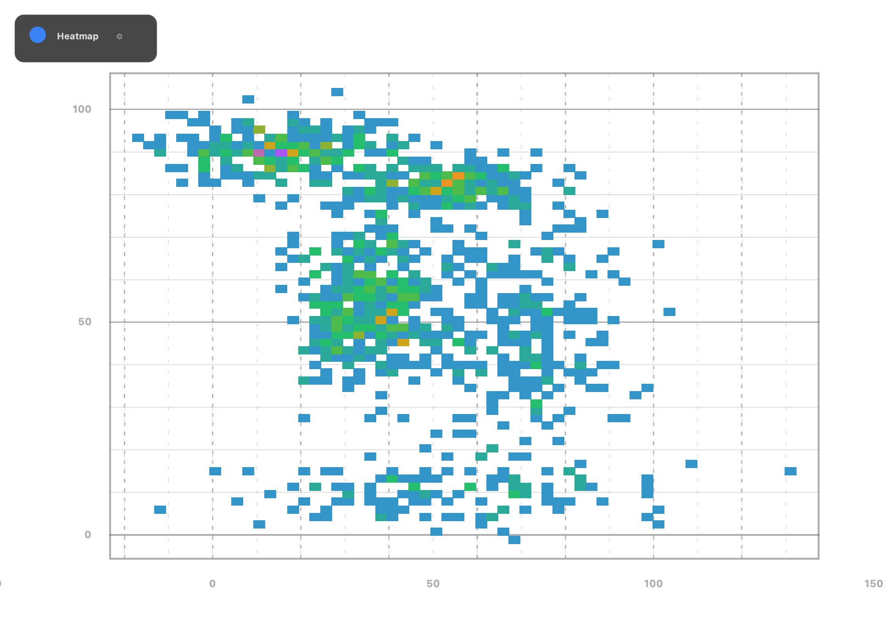
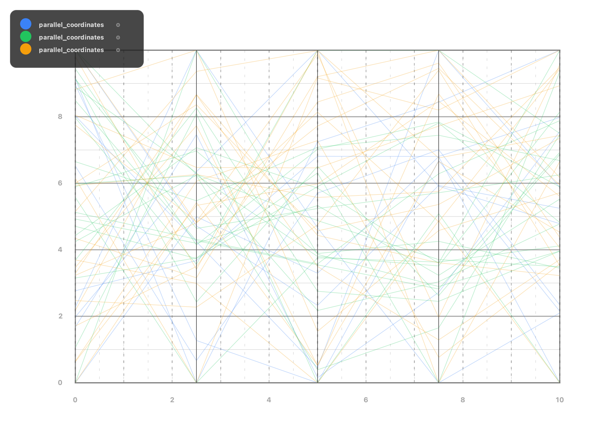
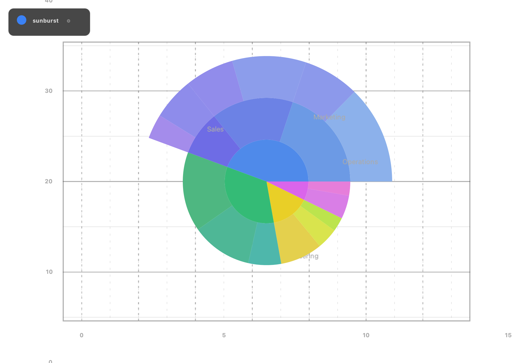

# ArberCharts


ArberCharts ist eine Java-25 Charting-Library fuer performante Datenvisualisierung auf dem JVM-Stack:
156 Renderer, Zero-GC-Renderpfade, SIMD-beschleunigt wo verfuegbar - und ohne spezielle JVM-Flags lauffaehig.

## Kurzbeschreibung

- Fokus auf High-Performance Rendering fuer Charts und technische Visualisierungen
- Serverseitiges Headless-Rendering (Spring Boot) und Swing-Desktop-Integration
- Vector API (SIMD) wird zur Laufzeit erkannt; ohne `--add-modules jdk.incubator.vector`
  greift transparent der skalare Fallback mit identischen Ergebnissen

## Bildvorschau (Renderer)








## Installation (Maven Central)

```xml
<dependency>
    <groupId>com.arbergashi</groupId>
    <artifactId>arbercharts-core</artifactId>
    <version>2.1.0</version>
</dependency>
```

Fuer Swing-Anwendungen zusaetzlich `arbercharts-swing-bridge`, fuer Server-Rendering
`arbercharts-server-bridge` oder direkt der Spring-Boot-Starter (siehe unten).

## Spring Boot Quick Start

Fuer serverseitiges Rendering (PNG-Export in REST-APIs, Reports, Batch-Jobs) genuegt der Spring-Boot-Starter:

```xml
<dependency>
    <groupId>com.arbergashi</groupId>
    <artifactId>arbercharts-spring-boot-starter</artifactId>
    <version>2.1.0</version>
</dependency>
```

Der Starter konfiguriert automatisch einen headless `ServerRenderService`
(Session-Pool, optional Micrometer-Metriken). Es sind keine JVM-Flags noetig.

```java
@RestController
public class ChartController {
    private final ServerRenderService renderService;

    public ChartController(ServerRenderService renderService) {
        this.renderService = renderService;
    }

    @GetMapping(value = "/chart.png", produces = MediaType.IMAGE_PNG_VALUE)
    public byte[] chart() {
        DefaultFinancialChartModel model = new DefaultFinancialChartModel("Demo");
        double price = 100.0;
        for (int i = 0; i < 500; i++) {
            double close = price + Math.sin(i * 0.08) * 2.5;
            model.setOHLC(i, price, Math.max(price, close) + 1.2, Math.min(price, close) - 1.2, close);
            price = close;
        }
        return renderService.renderToPng(model, new Dimension(800, 400));
    }
}
```

Konfiguration ueber `application.properties`:

```properties
arbercharts.server.pool-size=4
arbercharts.server.metrics-enabled=true
```

## Demo bauen und starten

```bash
mvn -pl arbercharts-demo -am package
java -jar arbercharts-demo/target/arbercharts-demo-*.jar
```

Die Demo aktiviert benoetigte Laufzeit-Flags selbst (Neustart-Mechanismus im Launcher).
Fertige Demo-JARs liegen den GitHub Releases bei.

## Dokumentation

- [Quick Start](docs/QUICK_START.md)
- [User Guide](docs/USER_GUIDE.md)
- [Renderer-Katalog](docs/RENDERER_CATALOG.md)
- [Release Notes](RELEASE_NOTES.md)

## Licensing

ArberCharts-Artefakte stehen unter der MIT-Lizenz.
Siehe `LICENSE`, `NOTICE` und `BINARY-LICENSE.md`.
Kommerzieller Support und SLAs: siehe [docs/PRICING.md](docs/PRICING.md).

## Support

gashi@pro-business.ch
https://www.arbergashi.com
