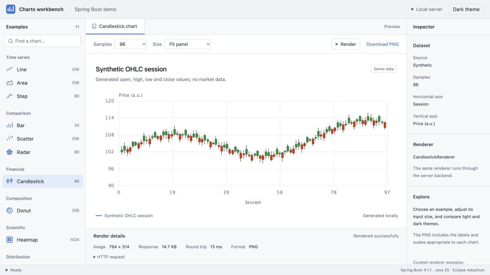
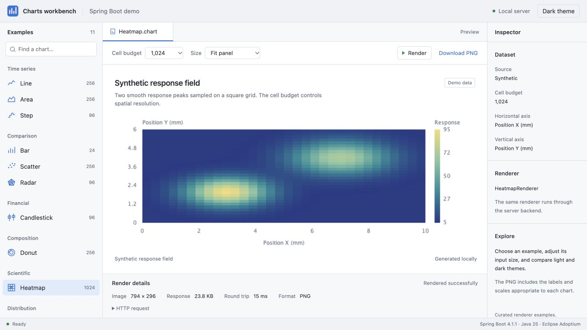
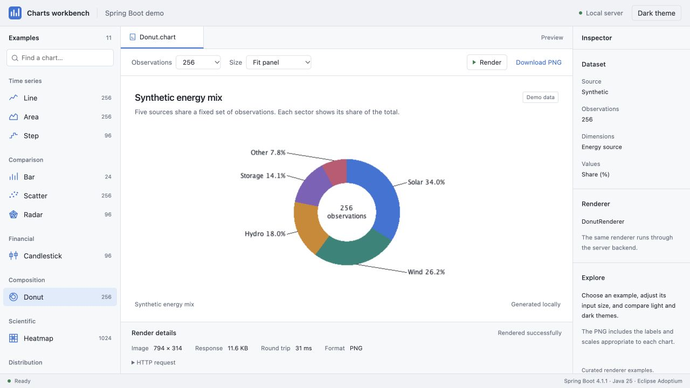
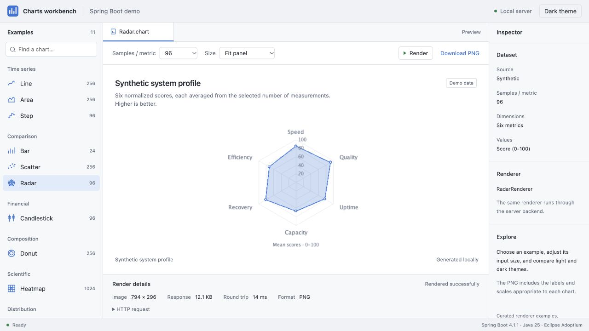
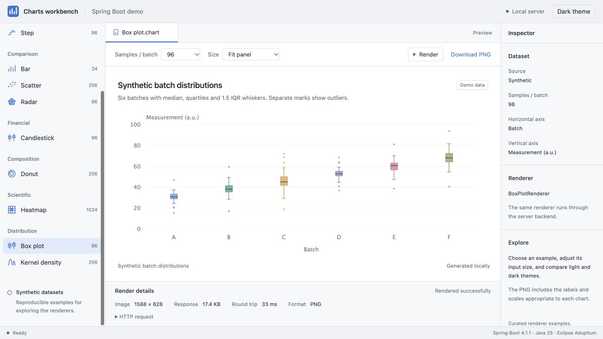
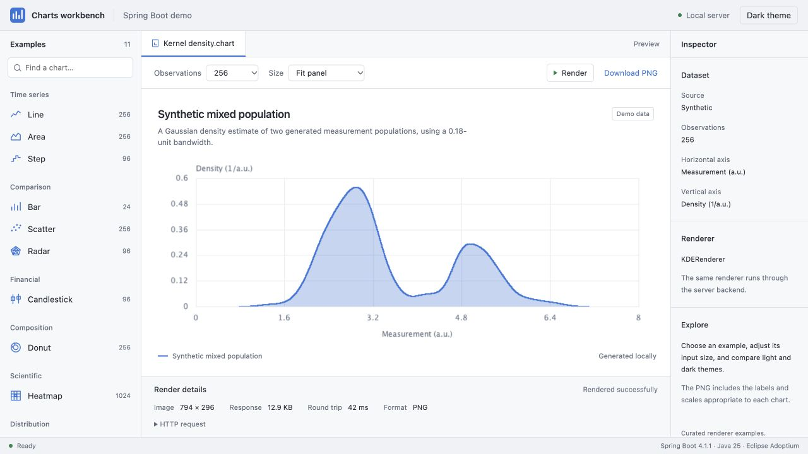

# Industrie Charts


Industrie Charts is a Java 25 charting library for technical data visualization on the JVM,
with a catalog of 156 entries, reusable rendering buffers, optional SIMD acceleration,
headless server output and Swing desktop integration.

**Current release: 2.2.0.** See the [release notes](RELEASE_NOTES_2.2.0.md) for
architecture changes, renderer corrections and migration details.

Core contains the platform-neutral models and renderer contracts. Swing and server
integration live in separate bridge modules. In 2.2.0, production Core is independent
of `java.desktop`; the Java2D server backend still requires that module in headless mode.
The Vector API is optional at runtime: without `--add-modules jdk.incubator.vector`,
supported operations use their scalar fallback.

The [rendering architecture](docs/RENDERING_ARCHITECTURE.md) explains frontend integration,
current text/spatial limitations, and the desktop APIs moving to the Swing bridge.

## Chart workbench gallery

Real browser captures of the **2.2.0 demo** show each chart
inside the complete workbench, with example navigation, settings and the dataset
inspector. All data is synthetic. The [Spring Boot workbench](arbercharts-spring-boot-demo/README.md)
includes these six examples and five further chart types with adjustable data
and export sizes. The images follow your preferred light or dark color scheme.

**Candlestick — OHLC session**

<picture>
  <source media="(prefers-color-scheme: dark)" srcset="arbercharts-spring-boot-demo/docs/screenshots/workbench-gallery/candlestick-dark.jpg">
  
</picture>

**Heatmap — spatial response**

<picture>
  <source media="(prefers-color-scheme: dark)" srcset="arbercharts-spring-boot-demo/docs/screenshots/workbench-gallery/heatmap-dark.jpg">
  
</picture>

**Donut — energy composition**

<picture>
  <source media="(prefers-color-scheme: dark)" srcset="arbercharts-spring-boot-demo/docs/screenshots/workbench-gallery/donut-dark.jpg">
  
</picture>

**Radar — system profile**

<picture>
  <source media="(prefers-color-scheme: dark)" srcset="arbercharts-spring-boot-demo/docs/screenshots/workbench-gallery/radar-dark.jpg">
  
</picture>

**Box plot — batch distributions**

<picture>
  <source media="(prefers-color-scheme: dark)" srcset="arbercharts-spring-boot-demo/docs/screenshots/workbench-gallery/boxplot-dark.jpg">
  
</picture>

**Kernel density — mixed population**

<picture>
  <source media="(prefers-color-scheme: dark)" srcset="arbercharts-spring-boot-demo/docs/screenshots/workbench-gallery/kde-dark.jpg">
  
</picture>

The [capture manifest](arbercharts-spring-boot-demo/docs/screenshots/workbench-gallery/manifest.json)
records the viewport, selected examples, themes and artifact checksum. Separate
[PNG exports](arbercharts-spring-boot-demo/README.md#standalone-chart-exports)
remain available for reports and direct renderer comparisons.

## Installation (Maven Central)

```xml
<dependency>
    <groupId>com.arbergashi</groupId>
    <artifactId>arbercharts-core</artifactId>
    <version>2.2.0</version>
</dependency>
```

For Swing applications add `arbercharts-swing-bridge`; for server rendering use
`arbercharts-server-bridge` or the Spring Boot starter directly (see below).

## Spring Boot quick start

For server-side rendering (PNG export in REST APIs, reports, batch jobs) the Spring Boot starter is all you need:

```xml
<dependency>
    <groupId>com.arbergashi</groupId>
    <artifactId>arbercharts-spring-boot-starter</artifactId>
    <version>2.2.0</version>
</dependency>
```

The starter configures a headless `ServerRenderService` automatically
(session pool, optional Micrometer metrics). No SIMD flags are required.
Headless rendering needs a JDK/runtime containing `java.desktop`, but no display server.

```java
@RestController
public class ChartController {
    private final ServerRenderService renderService;

    public ChartController(ServerRenderService renderService) {
        this.renderService = renderService;
    }

    @GetMapping(value = "/chart.png", produces = MediaType.IMAGE_PNG_VALUE)
    public byte[] chart() {
        DefaultFinancialChartModel model = new DefaultFinancialChartModel("Demo");
        double price = 100.0;
        for (int i = 0; i < 500; i++) {
            double close = price + Math.sin(i * 0.08) * 2.5;
            model.setOHLC(i, price, Math.max(price, close) + 1.2, Math.min(price, close) - 1.2, close);
            price = close;
        }
        return renderService.renderToPng(model, new Dimension(800, 400));
    }
}
```

Configuration via `application.properties`:

```properties
arbercharts.server.pool-size=4
arbercharts.server.metrics-enabled=true
```

## Build and run the demos

Use **Eclipse Temurin JDK 25** and **Maven 3.9 or newer**. The existing Temurin installation
is suitable; an Oracle JDK or a new machine-wide Java installation is not required.
CI also uses Temurin 25. The 2.2.0 baseline uses Spring Boot 4.1.1 and
JUnit 6.1.3; see the [dependency update record](docs/DEPENDENCY_UPDATES.md).

From the repository root, build fresh binaries, source JARs and English Javadoc JARs:

```bash
mvn -B -Djava.awt.headless=true clean verify
```

Run the exact staged artifacts for the current version:

```bash
# Swing gallery; requires a graphical desktop.
java -jar dist/releases/jvm/2.2.0/arbercharts-demo-2.2.0.jar

# Local browser demo backed by the server bridge.
java -Djava.awt.headless=true -jar dist/releases/spring-boot/2.2.0/arbercharts-spring-boot-demo-2.2.0.jar
```

The Swing launcher enables the runtime options it needs through its restart mechanism.
Swing launch scripts next to its staged artifact target that version's exact JAR.
The [Spring Boot demo README](arbercharts-spring-boot-demo/README.md) describes its local
browser interface and configuration. Published demo assets remain attached to their
respective GitHub releases; local staging does not publish a release.

For additional checks:

```bash
mvn -B -pl arbercharts-core -Djava.awt.headless=true test -Darbercharts.test.jvmargs=
mvn -B -Pquality-gate validate
```

The first command exercises the scalar fallback. See the [verification strategy](docs/VERIFICATION_STRATEGY.md)
for architecture, backend, lifecycle and renderer-smoke coverage. The
[independent rendering audit](docs/audits/2026-10-16-rendering/README.md) tracks remaining
axis, renderer and UI corrections; the current tests do not certify full visual correctness.

## Documentation

- [Quick Start](docs/QUICK_START.md)
- [User Guide](docs/USER_GUIDE.md)
- [Renderer Catalog](docs/RENDERER_CATALOG.md)
- [Rendering Architecture](docs/RENDERING_ARCHITECTURE.md)
- [Verification Strategy](docs/VERIFICATION_STRATEGY.md)
- [Documentation Index](docs/README.md)
- [Release Notes](RELEASE_NOTES.md)

## Licensing

The source code and artifacts are released under the [MIT License](LICENSE).
See [NOTICE](NOTICE) for copyright and third-party notice requirements.

## Project feedback

Report reproducible bugs and technical feature requests in
[GitHub Issues](https://github.com/ArberGashi/industrie-charts/issues).
