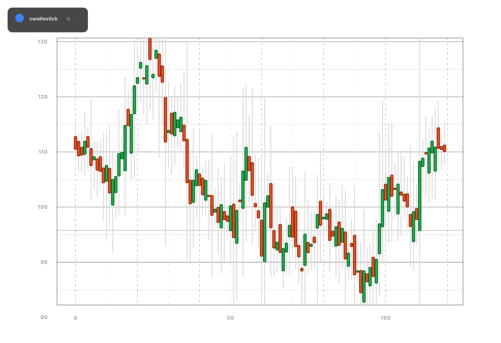
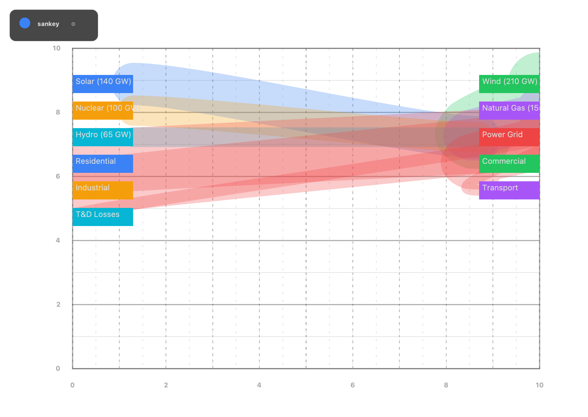
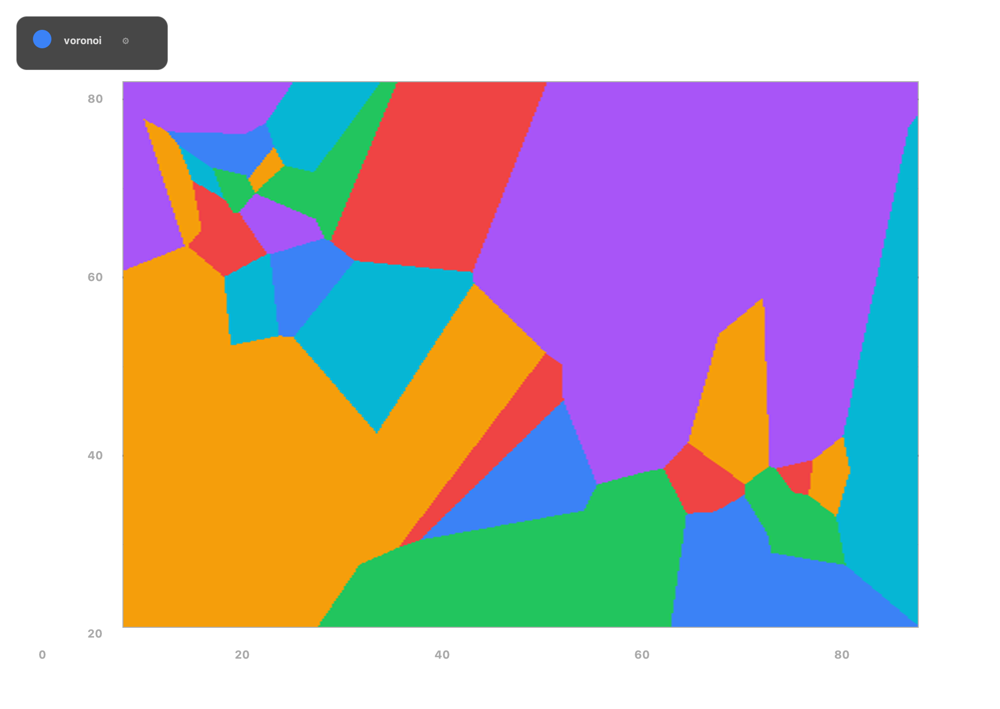

# ArberCharts 2.0.0 (Binary Release)


ArberCharts ist eine Java-25 Charting-Library fuer performante Datenvisualisierung auf dem JVM-Stack.
Dieses Repository enthaelt das oeffentliche Binary-Release (JARs), Startskripte und Vorschau-Assets fuer GitHub.

## Kurzbeschreibung

- Fokus auf High-Performance Rendering fuer Charts und technische Visualisierungen
- Bereitstellung als Binary-Artefakte (kein Source-Release in diesem Repository)
- Demo-App zum direkten Starten und Testen der Visualisierungen

## Bildvorschau (Renderer)







## Included Files

- `binaries/arbercharts-demo-2.0.0.jar`
- `binaries/arbercharts-core-2.0.0.jar`
- `binaries/arbercharts-starter-2.0.0.jar`
- `binaries/run-demo.sh`
- `binaries/run-demo.bat`
- `binaries/SHA256SUMS.txt`
- `site/images/` preview images
- `LICENSE`
- `NOTICE`
- `BINARY-LICENSE.md`

## Run Demo

```bash
java --enable-native-access=ALL-UNNAMED --add-modules jdk.incubator.vector -jar binaries/arbercharts-demo-2.0.0.jar
```

## Licensing

ArberCharts binary artifacts are distributed under the MIT License.
See `LICENSE`, `NOTICE`, and `BINARY-LICENSE.md`.

## Support

gashi@pro-business.ch
https://www.arbergashi.com
