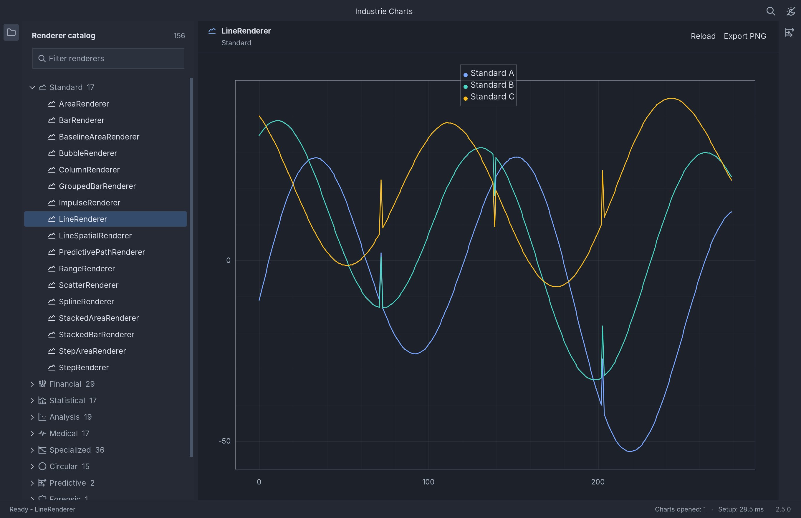
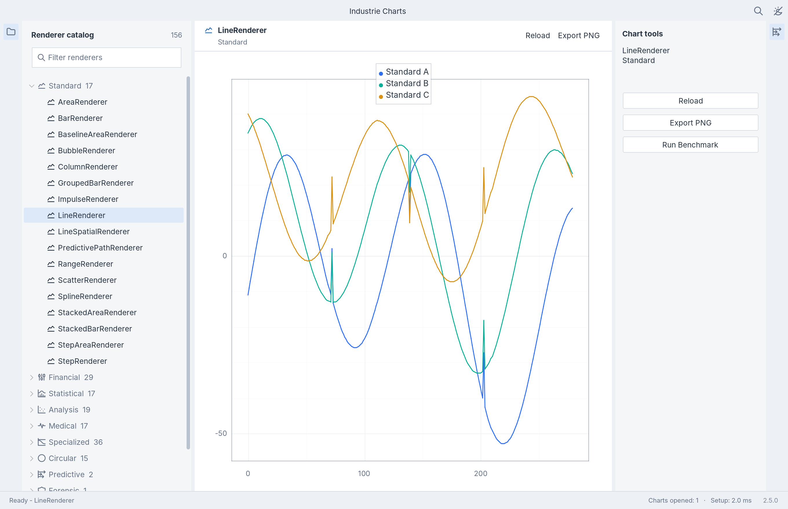
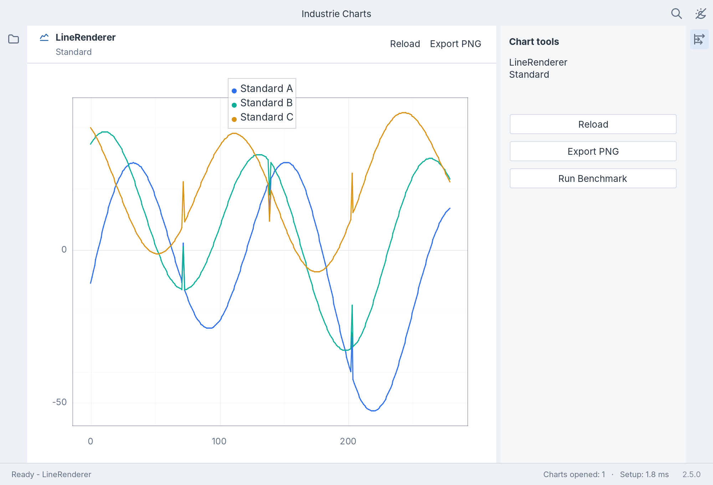
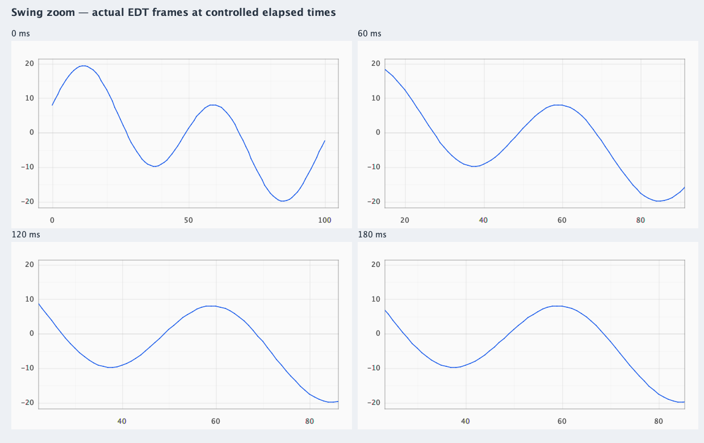

# Swing workbench

The Swing demo in 2.5.0 uses an IDE-style workbench: a compact application bar, a searchable
renderer catalog, and a chart workspace with its own actions. The visual hierarchy
is inspired by desktop development tools, including IntelliJ IDEA. The palette,
layout, and application identity are specific to Industrie Charts; no JetBrains
assets or theme files are included.

The images below were captured from the final packaged 2.5.0 demo. They show the
compact application title, the active chart and its actions, and the functional
side panels. The dark view shows the initial catalog layout; the light view
opens Chart tools alongside it. Capture details and the source JAR checksum are
recorded in the verification section.





## Design system

On macOS with full-window-content support, a compact title bar uses 36 logical
pixels before UI scaling, reserves space for the native window buttons, displays
the application title, and places renderer search and the theme switch on the right. Windows and Linux use
FlatLaf's embedded menu bar and application title with the same search and theme actions. The window
chrome has no separate logo or two-line branding band.

Persistent narrow side strips toggle the renderer catalog on the left and Chart
tools on the right. The catalog is open initially; Chart tools is closed. Both
panels can be resized with scaled six-pixel dividers. Their widths are retained
within the running workbench when hidden, reopened, or temporarily constrained
by the available space.
The active renderer and category remain visible above the chart. Reload and
Export PNG sit beside them when space permits, or move to a row below them when
the chart workspace is narrow. This keeps the side panels accessible with long
renderer names at a 1000-pixel window width and 150% UI scale; the macOS title
bar keeps its 36-logical-pixel height. The status bar reports chart setup time and
the actual artifact version obtained from Maven metadata.

About is available from Help and, where supported, the native macOS application
menu. The dialog shows the packaged version, catalog count, Java version and
vendor, operating system, Vector API availability, MIT license and copyright.
Its layout sizes to the content; Close, Enter and Escape dismiss it. The menu no
longer offers an unimplemented Preferences action.

Inter is loaded from the existing bundled font dependency and used at 13 points
for controls. Auxiliary labels use 11-12 points. The chart remains the main visual
content; the surrounding surfaces use small control radii and simple separators.

| Role | Dark | Light |
| --- | --- | --- |
| Application chrome | `#242832` | `#EDF0F4` |
| Chart workspace | `#1D2129` | `#FFFFFF` |
| Catalog surface | `#252A34` | `#F4F6F8` |
| Primary text | `#DCE1E9` | `#283442` |
| Secondary text | `#A0AAB8` | `#647185` |
| Accent | `#80A9E7` | `#2866AE` |

Both FlatLaf theme files define the same component keys. Chart colors are kept in
`src/main/resources/themes/charts.properties` so the chart background and UI
surfaces agree in both appearances.

## Interaction

The demo opens `LineRenderer` immediately. Filter the catalog by renderer name,
class name, or category. Enter opens the first result; Escape clears the filter.
The global Find renderer action searches across the catalog and clears a
conflicting sidebar filter when opening a result.

The side-strip buttons and View menu entries share their selected state. Opening
the catalog focuses its filter. Opening Chart tools focuses Reload when available,
or the renderer information otherwise. Closing a side panel returns focus to the
chart, with the chart toolbar as a fallback. Hiding either panel keeps its
component mounted, preserving the filter text, tree selection and current chart.

When there is room for only one side panel beside the chart, explicitly opening
either side takes precedence over keyboard focus in the previous panel. During
resizing without an open action, the workbench keeps the side containing keyboard
focus, or the most recently opened side if neither has focus. The other panel
closes, and its button and View menu entry reflect that state. It stays closed
when the window grows until explicitly reopened; the remembered panel widths
are preserved.

| Shortcut | Action |
| --- | --- |
| Cmd/Ctrl+1 | Show or hide the renderer catalog |
| Cmd/Ctrl+2 | Show or hide Chart tools |
| Cmd/Ctrl+F | Find renderer |
| Cmd/Ctrl+R | Reload selected chart |
| Cmd/Ctrl+E | Export selected chart as PNG |
| Cmd/Ctrl+T | Switch dark/light appearance |
| Cmd/Ctrl+B | Benchmark selected chart |

Cached chart views retain their state when revisited. In the standard
distribution, Chart tools shows the selected renderer and category, with Reload,
Export PNG and Run Benchmark. PDF and SVG entries appear in Chart tools and the
File menu only when their optional PDFBox and JFreeSVG backends are available;
these backends are not bundled with the demo. The controls share actions with
the menus, chart toolbar and applicable shortcuts. Exports and benchmarks target
the selected chart and are disabled while it is loading or unavailable. Reload
remains available for a selected renderer, including after a failed chart setup.

The paint benchmark runs on the EDT, with ten warmup paints followed by 100
measured paints. A Swing timer yields to input between frames; only each
`paintImmediately` call is timed. The demo pauses animation for the run and
restores the prior setting afterward. Hiding or disposing the chart, a paint
failure or an animation-setting change cancels the run; an explicit setting
change is preserved. Starting another run replaces the previous one. These
measurements describe the selected view and runtime, not a general throughput or
allocation guarantee.

Zoom responds to fractional trackpad input, accumulates rapid wheel gestures, and
settles smoothly from its current position. Dragging or resetting the view cancels
an older transition. Crosshair coordinates and labels move together immediately;
only their short opacity transition is animated.

Showcase signals advance from monotonic elapsed time while their card is visible.
Selecting another chart pauses the hidden signal; returning resumes its active
clock without a catch-up jump. Medical samples retain their 250 Hz simulation
cadence and revisit fixed positions within the six-second sweep window. The
spirometry and VCG examples update complete curves within their original
measurement domain. Animation preserves the selected viewport and calibration.
The 17 medical examples use renderer-specific synthetic data and units: ECG
leads, separate EEG rhythms, EMG activity, EOG gaze steps, pulse and pressure
waves, capnography, oxygenation trends, breathing traces and intensity views.
Fixed 25 mm/s and 10 mm/mV scaling is limited to ECG examples. The ventilator
shows explicitly normalized pressure, volume and flow on its shared axis;
frequency and depth views keep intensity separate from their Y coordinates.
The financial demo updates one visible live bar while preserving a
fixed history size. A long EDT stall is capped at 250 ms of simulated catch-up.
Reload, theme replacement, and disposal release animation timers and listeners.

Use `-Darbercharts.reduceMotion=true` before `-jar` to start the workbench without
interaction or showcase animation. Embedding applications can call
`ArberChartPanel.setAnimationsEnabled(false)` on the EDT to change this setting at
runtime; re-enabling it resumes the visible demo signal.



## Verification

The three workbench screenshots were captured on 2026-10-18 from the final shaded
`dist/releases/jvm/2.5.0/arbercharts-demo-2.5.0.jar` after the successful release
build. The captured JAR's SHA-256 is
`03e45e5c1c06fb7e3963550e883b9e56fd3bd55ea0491557e8763366be3f2c5f`.
Its packaged Maven metadata and the screenshot status bars identify version 2.5.0.

These are direct 2x paints of the actual `DemoApplication.buildWorkspace()`
component hierarchy on the EDT, using the installed Eclipse Temurin
25.0.4.1+1 JDK, FlatLaf 3.7.2 and JSVG 2.2.0. The harness verifies that the packaged
JAR supplies the application classes, reports its checksum, waits for the initial
chart, sets each side-panel layout and disables animation before painting. It
checks the primary series against the chart's Y bounds and disposes demo resources
after each capture. Native window buttons and the system menu bar are outside
these offscreen workspace captures.

| Image | Logical size | PNG size | Open side panels |
| --- | --- | --- | --- |
| `workbench-dark.png` | 1360 x 880 | 2720 x 1760 | Renderer catalog |
| `workbench-light.png` | 1360 x 880 | 2720 x 1760 | Renderer catalog and Chart tools |
| `workbench-light-compact.png` | 1000 x 680 | 2000 x 1360 | Chart tools |

All three images were reviewed for the application title, renderer identity,
chart and legend visibility, side-panel contents, action labels and version footer.
The compact image keeps Chart tools open while the catalog is collapsed. The
standard package offers PNG export; unavailable PDF and SVG backends are absent
from the displayed tools.

To reproduce the captures, select the existing Eclipse Temurin 25 JDK for `java`
and `javac`, then run from the repository root using the packaged JAR. Review new
images and record their source JAR checksum before replacing this evidence:

```bash
capture_dir="$(mktemp -d)"
demo_jar="dist/releases/jvm/2.5.0/arbercharts-demo-2.5.0.jar"
javac -cp "$demo_jar" -d "$capture_dir" docs/audits/2026-10-16-rendering/harness/WorkbenchScreenshots.java
java --add-modules jdk.incubator.vector --enable-native-access=ALL-UNNAMED \
  -Djava.awt.headless=true -Dflatlaf.uiScale=1 -cp "$capture_dir:$demo_jar" \
  com.arbergashi.charts.demo.WorkbenchScreenshots arbercharts-demo/docs/images
```

Automated interaction checks cover filtering, empty results, selecting across
filters, cached selection, reload, theme changes and PNG export from the active
chart. `DemoToolWindowWorkspaceTest` checks shared menu, button and shortcut
actions; retained filter, selection and catalog scroll state; remembered panel
widths; responsive side-panel priority; and optional export availability.
`DemoWorkbenchLayoutTest` checks the long-renderer-name layout in both themes,
1360 by 880 and 1000 by 680 logical pixels, 100% and 150% UI scale, and both the
macOS title-row and embedded-menu arrangements. All sixteen bundled SVG icons were loaded
and painted with JSVG 2.2.0. `DemoWorkspaceTest` retains regression coverage for
the default chart and export after returning to a cached view. Its export oracle
checks series-colored pixels at mapped data coordinates and rejects a solid
background. Animation regressions use a controlled monotonic clock on the EDT to
check cadence independence, rapid retargeting, cancellation, hidden-card resume,
reduced motion, and cleanup. The live financial bar is also compared in two actual
PNG exports. The four frames below were painted by the real Swing panel on the EDT
at controlled times, without opening a desktop window. They document geometry;
physical display cadence remains a separate desktop check. The 2.5.0
`DemoBenchmarkRunnerTest` additionally covers EDT-only painting, yielding between
frames, cancellation and restoration of animation state.



These checks run offscreen and do not establish full native keyboard or mouse
acceptance. Native title-bar gestures, keyboard focus, splitter dragging, file
dialogs and transitions between physical monitors require separate desktop
verification. The three screenshots document the initial `LineRenderer` and the
listed shell layouts. `DemoCatalogAcceptanceTest` separately exercises all 156
catalog selections in both themes through the actual workspace and checks their
rendered output. Those automated checks and these three screenshots do not
constitute visual acceptance of every renderer. Individual presentation findings
are tracked in the independent rendering investigation.

Run the automated demo tests with the existing local JDK:

```bash
mvn -pl arbercharts-demo -am test -Djava.awt.headless=true
```

Build and launch the desktop demo:

```bash
mvn -pl arbercharts-demo -am package -Djava.awt.headless=true
java -jar arbercharts-demo/target/arbercharts-demo-2.5.0.jar
```
