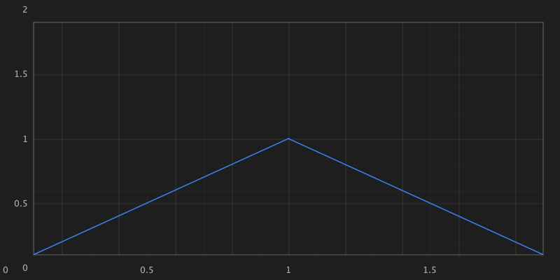

# Rendering audit — 16 October 2026

This independent investigation records presentation and numerical defects in the baseline before the authorized renderer, grid and host corrections. Its original results are retained for comparison with the corrected implementation. It does **not** approve the visual quality of the complete catalog.

- [Renderer and grid report](renderer-report.md): eleven prioritized findings, all catalog entries and demo aliases, grid dispatch results, and the regression corpus required for each family.
- [UI integration report](ui-report.md): ten finding groups covering medical scaling, axes, dock layout, legends, interaction, secondary axes, locale, freeze measurement, and export.
- [Subsequent correction record](corrections.md): implemented fixes, repaired test oracles and reviewed host images. The baseline reports and original evidence below remain unchanged.
- [Historical 2.2.0 verification record](verification.md): reactor and scalar results, the original demo captures and the acceptance limits recorded for that release.

## Coverage

| Evidence | Completed scope | What it does not establish |
| --- | --- | --- |
| Catalog inventory | All **156 entries** in the [catalog](../../../arbercharts-demo/src/main/resources/data/renderer-catalog.txt), actual demo construction/aliases, and normal/spatial dispatch | Visual or numerical correctness of every renderer |
| Targeted execution | **11 catalog entries** with independent command-level reproductions | Complete acceptance of those renderers |
| Additional focused source review | **145 catalog entries**, separate from the 11 executed entries; the original 43 plus 102 completed individual source records | Executed or visually confirmed results for those additional entries |
| Inventory and dispatch only | **0 remaining entries**; all 156 have focused static coverage | Static review does not prove every algorithm or approve appearance |
| Grids | All **11 concrete grids**, each called through Canvas and batch entry points; failures and empty output are retained | Complete geometry/style parity, or visual approval of successful calls |
| Non-catalog renderer | `SignalIntegrityLayer` and its builder installation were source-reviewed | Executed lost/recovered-state or accessibility acceptance |
| Swing UI | Production composition, axes, legends, crosshair/tooltip, scale, font, spatial, export and demo integration inspected; bounded headless probes executed | Real display calibration, full UI automation, animation/concurrency soak, or complete exports |
| Image inspection | One retained axes image was opened and visually inspected | A golden-image corpus or catalog-wide visual sign-off |

The 11 executed + 145 additional source-only catalog tiers are disjoint and total 156; zero entries remain inventory-only. The renderer report retains individual evidence and follow-up cases for all 102 entries added in the completion pass. No additional execution or catalog-wide image approval is implied. The existing smoke test includes 155 `ChartRenderer` entries and excludes the separate `PerformanceAuditRenderer` helper; smoke inclusion in the detailed matrix describes existing coverage, not a test run performed by this investigation. Primitive backend contract tests are a separate verification layer and do not certify chart layout or renderer semantics.

## Correction priorities

1. **Correct numeric interpretation:** medical presets currently miss the physical-density conversion ([UI-01](ui-report.md#ui-01--p1-medical-scale-presets-use-pixels-per-unit-as-if-they-were-millimeters-per-unit)); asymmetric box plots, stale indicator caches, and unfilled medical buffer slots produce incorrect geometry ([R1–R3](renderer-report.md#confirmed-correction-backlog)).
2. **Unify host coordinates and axis contracts:** dock layout, tick precision/placement, independent grid flags, repeated-series legend identity, coordinate transforms, secondary axes, and inverted input behavior. The reports distinguish executed failures from related source-only cases.
3. **Restore meaningful presentation:** renderer text and enabled overlays, theme changes, ternary/polar grid alignment, and visible measurement feedback need semantic fixtures plus reviewed images.
4. **Validate complete output paths:** preferred-size exports, optional grid batches, flow bounds, predictive BAR coordinates, histogram domains, and real spatial dispatch need focused regressions before the broader visual matrix is approved.

These are findings from the dated baseline. The separate [correction record](corrections.md) describes subsequent implementation and regression coverage; preserve the dated baseline output as historical evidence.

## Evidence and baseline

Both executable investigations used the previously built **2.2.0-SNAPSHOT shaded demo JAR**, originally located at `dist/releases/jvm/arbercharts-demo-2.2.0-SNAPSHOT.jar`. Current production sources were cross-checked while the independent architecture cleanup changed backend primitives and documentation. Those backend changes are not treated as unresolved renderer findings.

The JAR used to package and recheck these records had SHA-256:

```text
a8db525b7b7448eceac755a9e6cfbffe34e7a39f072663bb17c6c7df7fb2f6fb
```

Retained material:

| Material | Purpose |
| --- | --- |
| [ChartsRendererAudit.java](harness/ChartsRendererAudit.java) | Recording-Canvas probes of numeric geometry, text calls, state updates, themes, and all grids |
| [Renderer baseline output](results/renderer-baseline.txt) | Original command-level evidence; byte-identical on the packaging recheck |
| [InspectUi.java](harness/InspectUi.java) | EDT-based headless component, image, coordinate and formatting probes |
| [UI baseline output](results/ui-baseline.txt) | Reproduced component-state, coordinate and pixel-count evidence |
| [Axes image](assets/axis-bounds-baseline.png) | Visually inspected 800×400 example; byte-identical on the packaging recheck |



The Y label `2` is above the frame, the X label `0` is left of the plot, and the X label `2` falls beyond the image. The picture demonstrates that specific axis-range case. It is not an approved reference for all rendering behavior.

## Reproduce the probes

Use Java 25 and an existing shaded demo JAR from the current checkout. Run these commands from the repository root after the normal demo package build has completed. Change `audit_jar` when the project version changes; do not use a JAR or `target/classes` while a concurrent build is writing it.

```sh
audit_dir=docs/audits/2026-10-16-rendering
audit_jar=arbercharts-demo/target/arbercharts-demo-2.5.0.jar
audit_output=$(mktemp -d)
mkdir -p "$audit_output/classes" "$audit_output/ui"

javac --add-modules jdk.incubator.vector \
  -cp "$audit_jar" -d "$audit_output/classes" \
  "$audit_dir/harness/ChartsRendererAudit.java" \
  "$audit_dir/harness/InspectUi.java"

java -Djava.awt.headless=true --add-modules jdk.incubator.vector \
  -cp "$audit_output/classes:$audit_jar" ChartsRendererAudit \
  > "$audit_output/renderer-current.txt"

java -Djava.awt.headless=true --add-modules jdk.incubator.vector \
  -cp "$audit_output/classes:$audit_jar" InspectUi "$audit_output/ui" \
  > "$audit_output/ui-current.txt"

diff -u "$audit_dir/results/renderer-baseline.txt" "$audit_output/renderer-current.txt"
diff -u "$audit_dir/results/ui-baseline.txt" "$audit_output/ui-current.txt"
```

These shell commands target macOS/Linux. The UI program writes `axis-bounds.png` and `preferred-export.png` into the supplied output directory; it has no developer-specific path dependency. It also exits after its EDT work so Swing animation timers cannot keep the diagnostic process running. The renderer probe intentionally records known batch exceptions and missing output as evidence. Neither program is an acceptance-test suite: a zero process exit code does not mean the observed chart behavior is correct.

Differences from the retained outputs are expected after fixes and can also reflect font/platform changes. Check the semantic values and inspect new images before interpreting a diff. In particular, the original completely transparent preferred-size PNG is a demonstrated defect, not an output to preserve. Source line links in the reports refer to the inspected baseline and may move after implementation changes.

## Pending visual and integration matrix

| Area | Required follow-up before approval |
| --- | --- |
| Every catalog family | Execute the [family fixture corpus](renderer-report.md#regression-corpus-for-all-families) across all 156 entries and actual demo aliases/adapters; review semantic landmarks and images separately. |
| Rendering paths | Compare ordinary Canvas and actual Swing/server spatial dispatch for all five spatial-capable catalog classes; exercise isolated points, path breaks, fills, markers, dashes, clip and alpha. |
| Grids and coordinate domains | All eleven Canvas/batch pairs with default and explicit Z policies, nonlinear/inverted domains, ternary orientation, polar radii, per-axis visibility, tick density, and clipping. |
| Chart sizes and labels | Small/large, portrait/square/landscape, dense ticks, large/small numeric ranges, long labels/units, locale changes, collisions, missing text, and empty/singleton data. |
| Themes | Light/dark and distinct palettes; reuse the same renderer; overlays, selection/hover, legend docking, contrast and text legibility. |
| Real displays | Actual 1×, fractional and 2× OS scale; Retina/4K, mixed-DPI monitor transitions, supported font fallbacks, and crisp strokes/text. Headless scaling alone is insufficient. |
| Medical calibration | Known 1 mV/200 ms pulses; logical versus device density; physical measurement, resize, display moves, channel count, partial/full/wrapped sweep buffers and gaps. |
| Interaction | Pointer and keyboard behavior, zoom/pan focus, inverted axes, every dock side, per-series toggle/solo for repeated renderer types, tooltip/crosshair alignment and freeze feedback. Public accessibility helpers require actual integration verification. |
| Export | Realized and preferred-size-only panels, legend/overlay children, transparent/opaque backgrounds; PNG plus installed JFreeSVG and PDFBox output; typography, dimensions, clipping and physical scale. No full PDF/SVG visual approval was performed. |
| State and time | Same-length updates, equal-stamp replacement models, live prediction/anomaly/playback/watchdog states, signal-lost recovery, repeated frames, cleanup and concurrency/animation soak. |

The component inventory is complete within the stated chart-presentation scope. Full visual acceptance, surrounding demo gallery/dialog behavior, platform accessibility, and the matrix above remain work to perform; no report or retained image implies their completion.
