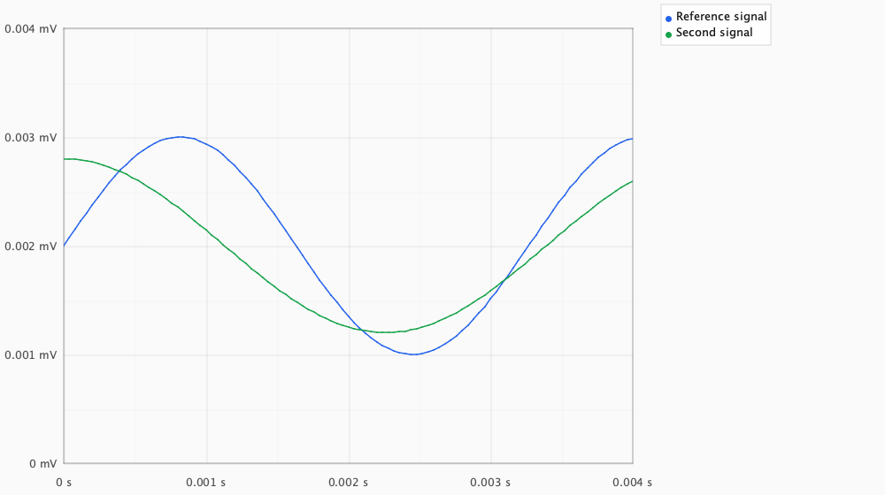
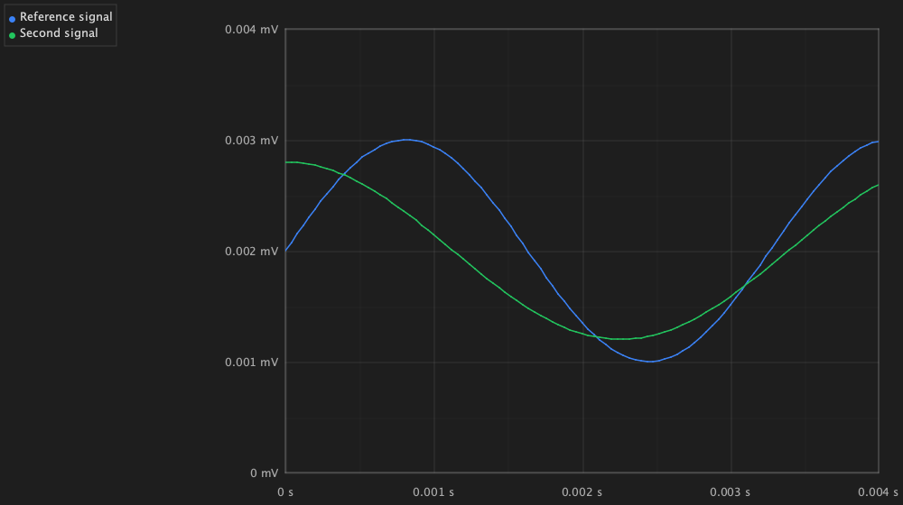

# Renderer, grid and host corrections

This record accompanies the **2.2.0** implementation. The
[independent baseline](README.md) remains unchanged as evidence of the original
defects. Corrections are supported by focused regression cases; they are not a
catalog-wide visual or numerical certification.

## Implemented correction groups

| Area | Corrected behavior | Regression evidence |
| --- | --- | --- |
| Financial indicators | Model identity, update stamps, point counts and relevant parameters invalidate derived-data caches. Renko retains earlier bricks when buffers grow. | `FinancialIndicatorCacheRegressionTest`, `FinancialGeometryRegressionTest` |
| Financial geometry | Hollow candles retain OHLC meaning through inversion, zoom and LOD. Point-and-figure reverses at three boxes. VolumeProfile and OBV use financial volume. | `FinancialGeometryRegressionTest` |
| Medical signals | Empty/unfilled slots do not become geometry. Wrapped histories use logical time order, channel renderers use real channel data and handle missing channels. | `MedicalRendererRingBufferTest` |
| Statistics | Explicit box quartiles/median, violin center/extrema, logical KDE observations with retained narrow peaks and Gaussian tails, empirical CDF steps, histogram coordinates/counts, inclusive live bins and collision-aware beeswarm positions. Preferred ranges describe the derived domain. | `StatisticalGeometryRegressionTest` |
| Analysis and prediction | Actual FFT/Fourier values, shape-preserving spline interpolation, logical ring-buffer order, finite time intervals, missing-data gaps, single coordinate conversion and applied threshold alpha. | `AnalysisStandardCorrectionTest` |
| Circular charts | Current palettes after in-place theme mutation, measured labels/center text, original indices for aggregated categories, matching drawn and interactive sectors including stroke endcaps, chord updates after resize/mutation, bounded sunburst rings and hierarchy replacement. Radar writes every vertex and closes rings/contours; missing values leave gaps. | `CircularRendererContractTest`, `RadarRendererGeometryTest` |
| Specialized charts | Correct negative-coordinate normalization, Pareto ordering and original indices, layout/cache refresh, bounded flow/horizon layouts, complete spectrogram samples, actual last sparkline point and explicit contour color interpolation. | `SpecializedRendererRegressionTest`, `DelaunayRendererRegressionTest` |
| Grids | All eleven batch paths reuse Canvas geometry. Ternary and polar families share coordinate geometry; grid depth, clipping and independent axis visibility are respected. | `GridGeometryContractTest` |
| Spatial dispatch | Independent markers remain independent, singletons render, Smith trace/markers survive wrappers, ARGB is retained, path metadata survives reset/growth and sorted chunks snapshot reused buffers. | `SpatialPointMetadataTest`, `SpatialPathBatchBuilderTest`, `DepthAwareBatchConsumerTest`, `SpatialRendererBackendContractTest` |
| Text and overlays | Swing/server draw text with actual font metrics. Enabled latency/performance/playback/physical-scale overlays emit readable content; native text retains its existing protocol. | `CanvasTextContractTest`, `OverlayTextContractTest`, `NativeTextContractTest` |
| Swing host | Canvas-local docking, measured and bounded tick labels, locale precedence, distinct series legends, secondary Y contexts and crosshair/tooltip precision, forward/inverse transforms, stable zoom focus, visible freeze feedback and physical units. | `PresentationContractTest`, `AxisPresentationFormatTest`, existing Swing interaction suites |
| Export and backend state | Unrealized panels export actual content and restore sizes. Canvas clip restoration observes current Swing host rectangles. Server ranges use renderer preferences while preserving explicit bounds; frames and resources remain isolated across pool reuse. | `ChartExportServiceTest`, `CanvasBackendContractTest`, `ServerRenderServiceTest` |
| Demo lifecycle | Reload, theme replacement and disposal close demo-owned asynchronous function renderers. Smoke cases release their own closeable renderers. | `DemoWorkspaceTest`, `RendererSmokeTest` |
| Swing animation | Fractional wheel input accumulates without losing the current pointer anchor. Crosshair position and labels remain synchronous while opacity fades. Hidden demos pause active time, financial updates preserve history, and vector arrows share one held frame time. Timers and model listeners are released. | `InteractionAnimationTest`, `CrosshairAnimationTest`, `PanelModelLifecycleTest`, `ShowcaseAnimationTest`, `ShowcaseFinancialModelTest`, `DemoWorkspaceTest` |

## Test-oracle corrections

Existing tests were reviewed as code, rather than treated as an infallible
specification. The following concrete weaknesses were corrected:

- A nonzero CRC can describe a completely transparent image. Renderer image
  fixtures now require nonzero pixel alpha and include a deliberately empty
  renderer that must fail the content check. Hash comparison still checks
  repeatability, not agreement with an approved image baseline.
- The old `RasterTestCanvas.fillPolygon` drew only outlines; rectangle extents
  also included an extra row and column. The test-only canvas now uses actual
  Java2D fills, clipping, alpha compositing and text. Production Core remains
  free of desktop dependencies.
- The old depth-sort stability test used identical X/Y coordinates for both
  chunks. Distinct coordinates now expose ordering errors; new cases also reuse
  the same source buffer before flushing.
- Tooltip exception tests previously iterated listeners on an outer component
  that did not receive the input. They now dispatch events to the actual chart
  canvas on the EDT.
- Text edge checks compare premultiplied colors with bounded raster rounding;
  opaque interior coverage, clipping and measured positions remain asserted.
  Antialiasing is not mistaken for an incorrect source color.
- Numeric tests use explicit landmarks and independent references, including
  asymmetric quartiles, OHLC/volume values, DFT amplitudes, three-box reversals,
  logical ring-buffer time order and Gaussian kernel peaks/tails.
- A single sampled series point can be covered by another series. The demo
  export oracle checks the expected series color at multiple mapped data
  positions and rejects a solid background. It also caught a missing initial
  autoscale after all three demo series were installed; their complete ranges
  are now included before the first view is shown.
- The old circular image fixtures supplied explicit zero minimum and maximum
  values alongside nonzero measurements. The Radar context therefore had no
  usable radial range, and the image check had only established grid output.
  Those fixtures now use the ordinary point overload, with a separately asserted
  Radar data maximum. Independent vertex assertions check the profile itself.

## Reviewed host images

These are actual Swing/Java2D renders of two separately named series with small
numeric ranges, units and docked legends. They were inspected in light and dark
themes after the coordinate and tick-label corrections.

## Remaining acceptance boundaries

KDE preparation preserves all distinct observations and their multiplicities.
It compares actual logical contents before reusing prepared densities, including
when a model's update stamp is unchanged. The preparation cost remains
`O(n log n + u²)` in the worst case for `n` observations and `u` distinct values
with overlapping kernels. Unchanged queries scan `O(n)` observations; drawing
also maps the cached curve. This is not a constant-time streaming guarantee.

The full [verification strategy](../../VERIFICATION_STRATEGY.md) describes build
and regression commands. Real-display medical calibration, fractional/mixed DPI,
complete PDF/SVG export comparison, animation/concurrency soak and performance
measurements are separate acceptance work. No functional test proves universal
zero allocation.

The generic summary model does not contain raw per-category distributions for
true violin densities or a multi-group ridgeline layout. Those renderers retain
their explicitly documented summary/single-ridge contracts. Logarithmic mapping
is covered in geometry checks; a dedicated decade/mantissa label-density policy
and a catalog-wide visual corpus are not established by this correction pass.
